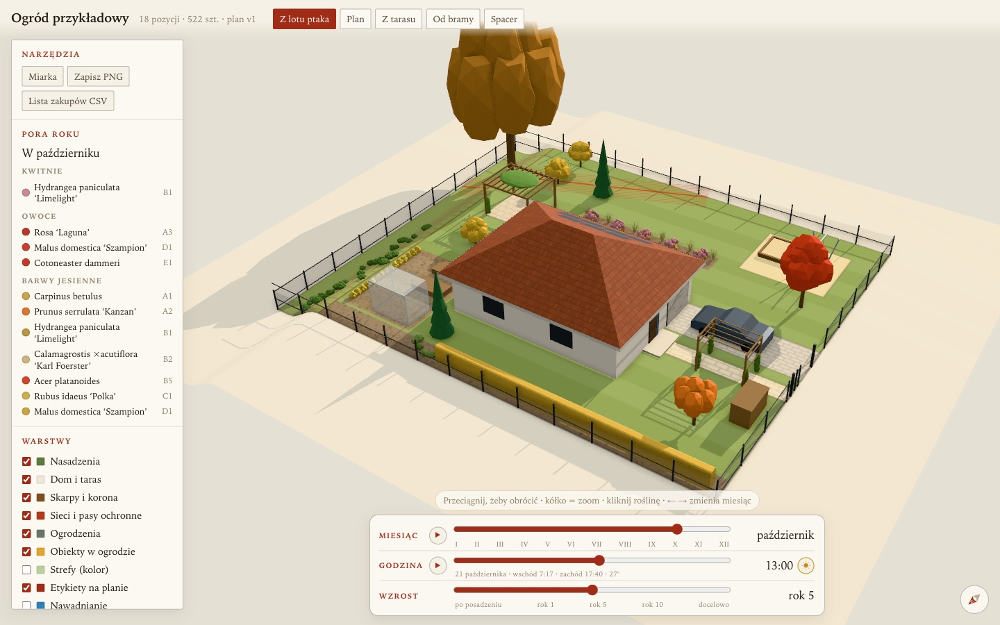

# agent-skills

Claude Code skills I wrote for my own work and cleaned up enough to share. The repo is a plugin marketplace, so you can install straight from it.

```
/plugin marketplace add plrojek/agent-skills
/plugin install garden-3d-viewer@plrojek
```

From a shell it's `claude plugin marketplace add plrojek/agent-skills`, then `claude plugin install garden-3d-viewer@plrojek`. If you don't want plugins, copy `plugins/garden-3d-viewer/skills/garden-3d-viewer` into `~/.claude/skills/` and it works the same way.

## garden-3d-viewer



Turns a planting plan into a 3D garden you open in a browser. A month slider for the seasons, a growth slider from planting day to mature size, the real sun for any hour, walking at eye level, a tape measure, a PNG of the plan, a shopping list with a CSV export, a map of sun hours and an irrigation layer. Static files and three.js, no build step, nothing on a server.

The plan lives in one place. You keep it as Python tables, an exporter writes `garden-scene.json`, and the viewer draws only what that file says. `templates/example/build_scene.py` is a complete exporter for a made-up plot. Run it first: if the example shows a house, plants and a working month slider, any later problem is in your data.

I built this for my own garden. Ask Claude something like "show my planting plan in 3D" or "how much sun does the terrace get in July" and it should pick the skill up.

A few things to know:

- The interface ships in Polish. The texts sit in three places: the `T` table at the top of `garden.js`, month names in `site.js`, labels in `index.html`. `meta.ui` in the scene overrides the title, currency and layer names.
- `scripts/fetch_three.sh` downloads three.js r180 from jsDelivr into `vendor/` and rewrites the add-on imports, so the page needs no import map and makes no third-party requests once it's deployed.
- The scene file holds your plot outline, the house and coordinates good to about a kilometer. If it's your real home, don't put it on a public URL. `SKILL.md` has a note on keeping the whole folder private, not just the page.

## License

MIT. three.js, which the script downloads, is MIT as well.
