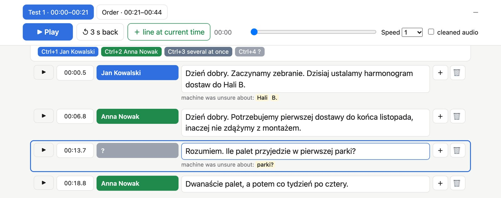

# transcript-review

An accurate transcript with named speakers from a noisy recording with several people, made with local models and checked by ear on a review page in your browser.

```
/plugin marketplace add plrojek/agent-skills
/plugin install transcript-review@plrojek
```



I needed exact words, and who said them, from a 44-minute recording made on one phone outdoors: five people, one side of a phone call on loudspeaker, wind, people talking over each other. The first transcript had invented words and no speakers. This skill gets as close as local models can, then has you listen to the passages that matter.

1. It cuts the speech into chunks of up to 28 seconds and runs four systems on them: Whisper large-v3 on lightly filtered audio for the text, and large-v3 on the raw audio, large-v3-turbo and NVIDIA Parakeet v3 as second opinions. Parakeet also gives the word timings, because Whisper's drift.
2. It opens a review page on localhost. You correct four test passages of a minute or so by ear: one line per person, Enter splits a line, Ctrl+1…8 sets who is talking, a time box moves a line.
3. `score` measures every system against your passages and says which is best on this recording.
4. `voices` learns each person's voice from the lines you checked and assigns speakers to the rest. People who spoke once or twice appear only where you put them, and a phone caller only inside the call.
5. `build` writes a Markdown transcript. Lines you checked are marked ✓, words that fewer than half of the other models heard are in italics, weak speaker matches get "(?)".

Nothing is filled in from context: every word comes from a model or from you.

On my recording, in Polish, large-v3 on filtered audio got an 11.1% word error rate on the checked passages; the other 15 combinations of model and audio got 14.9 to 48.3%. Noise removal with DeepFilterNet made every model worse, so the skill keeps it for listening only. Voting across the models was worse than the best model alone. The italics mark 10% of the words and catch about 61% of the errors. The voice models put the right person on 96 to 98% of held-out checked lines. All of it is in `references/lessons.md`, and it's one recording, so `score` measures again on yours.

I built it on my experience from Wasabi, where I worked on multilingual speech-to-text and diarization pipelines. Ask Claude something like "transcribe this recording with who said what" and it should pick the skill up, ask who was there and which moments matter, and walk you through the page.

A few things to know:

- It needs a Mac with Apple Silicon (Parakeet runs on MLX), `uv`, `ffmpeg` and whisper.cpp: `brew install uv ffmpeg whisper-cpp`. The first run downloads about 5 GB of models.
- Everything runs on your computer and the audio never leaves it. The review server listens on 127.0.0.1 and refuses requests from other sites.
- On an M4 Pro the models take about 15 minutes for 45 minutes of audio. The four test passages took me 30 to 40 minutes, including learning the page.
- It was tuned on Polish. Other languages Whisper knows should work, but I haven't measured them.

## What it runs, downloads and sends

The skill tells Claude to run its Python scripts on your Mac; there are no hooks and no MCP servers.

- **Programs it runs:** `ffmpeg` (audio conversion and the light filter), `whisper-cli` from whisper.cpp, `uv` (Python 3.13 with exact package versions: `num2words==0.5.14`, `sherpa-onnx==1.13.8`, `numpy==2.5.4`, `parakeet-mlx==0.5.3`), and `deep-filter` only if you have it installed.
- **Downloads on the first run** (about 5 GB, into `~/whisper-models` and `~/asr-models`, or the folders in `WHISPER_MODELS` / `ASR_MODELS`): Whisper large-v3 and large-v3-turbo from `huggingface.co/ggerganov/whisper.cpp`; Parakeet `mlx-community/parakeet-tdt-0.6b-v3` from Hugging Face; the pyannote segmentation and CAM++/ERes2Net/ERes2NetV2 voice models from the `k2-fsa/sherpa-onnx` releases on GitHub; and the Python packages above from PyPI through uv.
- **Your recording stays on your computer.** Nothing is uploaded. The audio, the model outputs, your corrections (`corrections.json`, with a copy every five minutes in `corrections-backups/`) and the transcript are files in the work folder you choose, and they stay there until you delete them. A recording of people is personal data, so keep that folder somewhere private.
- **The review page** is served by a small Python server on `127.0.0.1` only. It answers requests addressed to that address and saves only from its own page.

## License

MIT. Source: [github.com/plrojek/agent-skills](https://github.com/plrojek/agent-skills).
